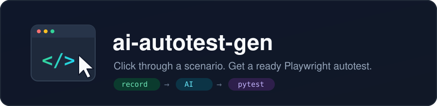
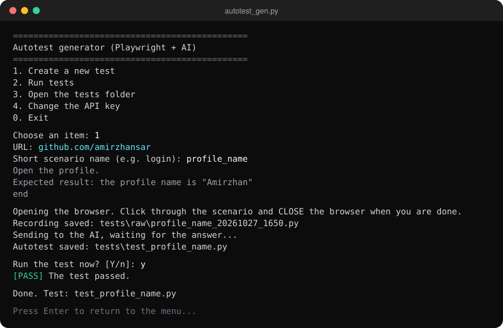
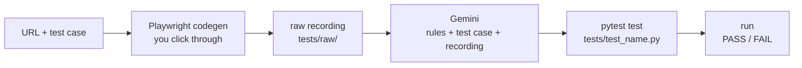
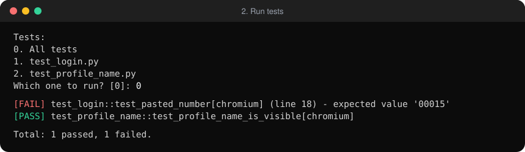

<div align="center">



# ai-autotest-gen

**Click through a scenario in the browser. Paste your test case. Get a ready Playwright autotest.**

[](https://github.com/amirzhansar/ai-autotest-gen/actions/workflows/ci.yml)


[](LICENSE)

[Why](#-why-ai-autotest-gen) · [Quick start](#-quick-start) · [Features](#-features) · [How it works](#-how-it-works) · [Good test cases](#-writing-a-good-test-case) · [FAQ](#-faq)



<sub>One menu item: open the site, click through, close the browser, get a test.</sub>

</div>

---

## 💡 Why ai-autotest-gen?

Turning a manual test case into an autotest usually means hunting for selectors in DevTools, writing boilerplate, and remembering to add checks. Playwright's recorder helps with the selectors, but its output is a raw list of clicks with no assertions. **ai-autotest-gen** connects the two halves: you record the clicks, you provide the test case, and the AI writes the test that checks what the test case expects.

| | Writing by hand | Playwright codegen only | **ai-autotest-gen** |
|---|:---:|:---:|:---:|
| Selectors found for you | — | ✅ | ✅ |
| Assertions from the expected result | ✍️ by hand | — | ✅ |
| Reproduces *how* the user acted (typing vs Ctrl+V paste) | ✍️ by hand | partly | ✅ |
| Junk clicks cleaned up | — | — | ✅ |
| Guessed parts clearly marked | — | — | ✅ |
| One-line pass/fail report | — | — | ✅ |

## 🚀 Quick start

1. **Get a free Gemini key** at [aistudio.google.com/app/apikey](https://aistudio.google.com/app/apikey).
2. **Run the program** — double-click `autotest_gen.py`. On the first run it installs everything it needs and asks for the key (press Enter on an empty line to open the key page).
3. **Create a test** — menu item `1`: paste the URL and the test case, click through the scenario, close the browser.

That's it. The test is in `tests/test_<name>.py` and runs with plain `pytest`.

## ✨ Features

<table>
<tr>
<td width="50%" valign="top">

**🎬 Record, don't write**
Playwright codegen opens the site; every click and input becomes code with stable locators.

**🧠 Test case → assertions**
Expected results from your test case become `expect(...)` checks — URLs, visible texts, field values.

**📋 Real user behavior**
A paste is tested as a real Ctrl+V through the clipboard, not as a `fill()` that bypasses the bug.

**🏷️ Honest about guesses**
When the recording lacks an element, the AI still writes the step but marks it with `# AI-GUESS:` and the program tells you how many there are.

</td>
<td width="50%" valign="top">

**🔗 URL validation**
Typos, spaces and non-sites are caught before the browser opens; internal hosts behind a VPN get a warning, not a block.

**♻️ Survives a busy AI**
Retries with a countdown, follows Google's model renames, falls back to other Gemini Flash models.

**📊 One line per test**
Menu item `2` runs all tests or one, with a slow visible browser and a short `[PASS]` / `[FAIL]` report.

**🧰 Zero setup**
One file. Libraries, browser and key are handled on the first run.

</td>
</tr>
</table>

## 🧩 How it works



1. You give a URL and a test case: steps, data, expected result.
2. The browser opens with the Playwright recorder. You perform the steps and close the browser.
3. The recording and the test case go to Gemini together with a fixed set of rules: take locators from the recording, take expected values from the test case as is, reproduce the user's actions faithfully, mark anything guessed.
4. The answer is saved as a pytest file and, if you want, run once right away.

The AI does **not** edit a test after it fails. A failing test is a result for you to judge — a bug on the site or a mistake in the test — not something to be silently "fixed".

## 📸 A closer look

<div align="center">

<br><sub>Menu item 2: one line per test, the failing line and the reason.</sub>
</div>

An example of a generated test is in [`examples/test_profile_name.py`](examples/test_profile_name.py).

## ✍️ Writing a good test case

The output is only as good as the input. What works best:

| Do | Avoid |
|---|---|
| Numbered steps, one action each | One long sentence with everything |
| Explicit data: `type 00ZP-00015`, `password Qwerty123` | "enter a valid number" |
| Checkable result: `the page https://site.kz/profile opens` | "everything works" |
| Exact text in quotes: `"Welcome, Amir" is visible` | "the user sees a greeting" |
| One thing to verify per test case | 10-step end-to-end journeys |

While recording, click every step from the test case. To check a text that is already on the page, use the **ab** (assert text) or **eye** (assert visibility) button in the recorder and click the element.

```text
1. Open the sign-in page
2. Paste 00ZP-00015 into the employee number field (Ctrl+V)
3. Enter the password Qwerty123 and click "Sign in"
Expected result:
2. The field shows 00015 (the prefix is not duplicated)
3. The page https://app.example.kz/home opens, "Amir Sartayev" is visible
end
```

## 📋 Requirements

| | |
|---|---|
| OS | Windows 10/11. Recording, generation and runs also work on macOS/Linux; "Open the tests folder" and the recorder window renaming are Windows-only. |
| Python | 3.10 or newer |
| AI | Free Google Gemini API key |
| Network | Internet for the first install and for every AI request |

## 📥 Install

```bash
git clone https://github.com/amirzhansar/ai-autotest-gen.git
cd ai-autotest-gen
python autotest_gen.py
```

> [!NOTE]
> On the first run the program installs `pytest-playwright` and `google-genai` and downloads Chromium (a couple of minutes). Your key is saved to `autotest_config.json` next to the program.

> [!IMPORTANT]
> `autotest_config.json` and the `tests/` folder are in `.gitignore`. Keep it that way: the first holds your API key, the second may hold passwords and internal URLs from your test cases.

Generated tests are ordinary pytest files and run without the program:

```bash
python -m pytest tests -v --headed
```

## ⚙️ Configuration

Settings are constants at the top of `autotest_gen.py`.

| Constant | Default | What it does |
|---|---|---|
| `GEMINI_MODEL` | `gemini-3.8-flash` | Main model. Updated automatically if Google retires it. |
| `SLOWMO_MS` | `500` | Pause between browser actions during runs, in ms. `0` for full speed. |
| `INSPECTOR_TITLE` | `Autotest Recorder` | Title shown instead of "Playwright Inspector". |
| `RETRY_WAITS` | `[10, 20, 40]` | Seconds between retries when Gemini is overloaded. |
| `SYSTEM_PROMPT` | rules text | The rules the AI follows. Change behavior here, not in the code. |

## ❓ FAQ

**Is it free?**
Yes. The Gemini API has a free tier; it is rate-limited, so on a busy day you may wait or switch models automatically.

**What gets sent to Google?**
The URL, your test case and the click recording — including any passwords and data you typed. Do not use it with real customer data or secrets your company does not allow to share with external AI services. Free-tier requests may be used by Google to improve its models.

**What does `# AI-GUESS:` mean?**
The recording had no element for that step, so the AI picked the most likely locator. Check these lines first when a test fails.

**The test failed. Is it a bug?**
Maybe. Look at the reason line: a mismatch in `expect(...)` (text, URL, value) usually points to the site; a timeout on a line marked `AI-GUESS` usually points to the test.

**Why does it not fix failing tests automatically?**
It used to. An AI that "fixes" a failing test tends to change the expected value to whatever the site shows — hiding exactly the bug the test was written to catch.

**Can I use another AI?**
Not out of the box. Only Gemini is supported and tested.

## 🧰 Development

```text
ai-autotest-gen/
├── autotest_gen.py          # the whole program
├── selftests/               # unit tests for helpers (no browser, no AI)
├── examples/                # a sample generated test
├── docs/                    # images for this README
├── requirements.txt
└── .github/workflows/ci.yml # lint + self-tests on Python 3.10–3.13
```

```bash
pip install pytest pyflakes
pyflakes autotest_gen.py selftests
pytest selftests -v
```

---

<div align="center">
<sub>Made for QA engineers who'd rather test than type selectors · <a href="LICENSE">MIT License</a> · <a href="#ai-autotest-gen">Back to top</a></sub>
</div>
